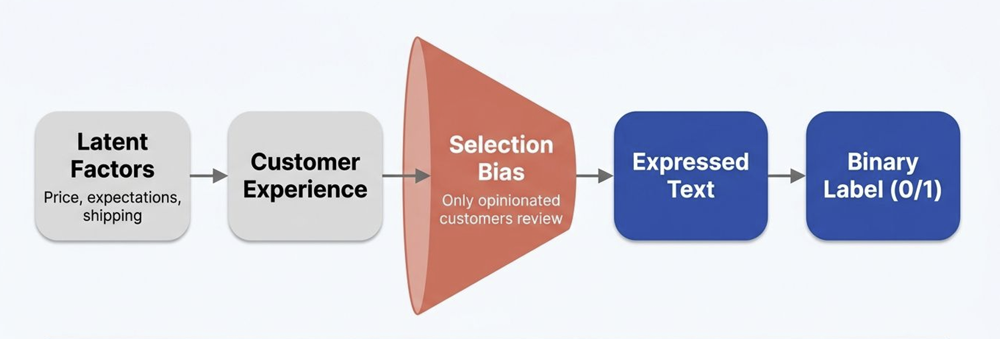
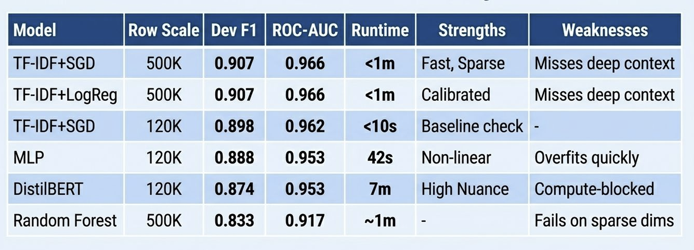
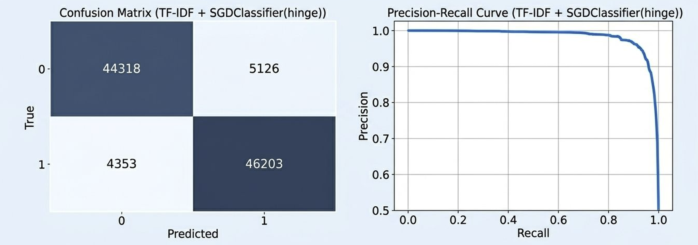

# Amazon Reviews Sentiment Analysis

**Natural Language Processing | Machine Learning | Python | TF-IDF | Deep Learning**

An end-to-end NLP project for classifying Amazon customer reviews as **positive or negative**. The project explores text preprocessing, feature engineering, supervised learning, unsupervised clustering, neural networks, and model evaluation.

The analysis compares multiple machine learning approaches and recommends an efficient, interpretable **TF-IDF + SGD classifier** under the available computational constraints.

## Project Overview

Customer reviews contain valuable information about customer experiences and opinions. Automatically identifying sentiment can support review analysis, customer feedback monitoring, and large-scale text analytics.

This project investigates how different text representations and classification models perform on Amazon product reviews.

**Research question:** Which NLP approach provides the best balance of sentiment classification performance, computational efficiency, and interpretability?

## Dataset

**Source:** [Amazon Reviews Dataset — Kaggle](https://www.kaggle.com/datasets/bittlingmayer/amazonreviews)

The dataset contains:

- **3.6 million training reviews**
- **400,000 held-out test reviews**
- Binary sentiment labels: negative (0) and positive (1)
- Balanced positive and negative classes

The original dataset is not included in this repository because of its size. Experiments use smaller training subsets where necessary to manage computational requirements.

## Data Generating Process and Selection Bias



The analysis recognizes that customer reviews are not necessarily representative of all customer experiences.

Customers choose whether to leave reviews, and strongly positive or negative experiences may be overrepresented.

**Important distinction:** The model predicts sentiment expressed in review text, not objective product quality or customer satisfaction across the entire customer population.

## Technologies and Libraries

- **Python:** Data processing and machine learning
- **Pandas and NumPy:** Data manipulation
- **Scikit-learn:** Feature extraction, classification, clustering, and evaluation
- **TF-IDF:** Sparse text representation
- **PyTorch:** Neural network experiments
- **Hugging Face Transformers:** DistilBERT modeling
- **Matplotlib and Seaborn:** Data visualization
- **Jupyter Notebook:** Experimentation and analysis

## Methodology

### 1. Exploratory Data Analysis

The project examines:

- Class balance
- Review length distributions
- Common positive and negative terms
- Vocabulary patterns
- Potential sources of bias

The analysis also investigates challenges involving negation, such as phrases like *not good*, where individual word frequencies may not fully capture sentiment.

### 2. Feature Engineering

Multiple text representations were explored:

| Representation | Purpose |
|---|---|
| TF-IDF with unigrams and bigrams | Sparse features for linear classification |
| Sentence embeddings | Semantic representation for clustering |
| Subword tokenization | Contextual input for DistilBERT |
| Review length | Additional feature tested through ablation |

TF-IDF was configured with up to 300,000 features for the main linear models.

Feature extraction was designed to fit vocabulary statistics on training partitions rather than on held-out evaluation data.

### 3. Unsupervised Learning

The project investigates patterns in customer reviews using:

- Dimensionality reduction with Truncated SVD
- K-Means clustering
- Sentence embeddings
- Silhouette scores

The clustering experiments explore whether reviews naturally group by sentiment or by product-related vocabulary and semantic similarities.

These clusters were used for exploratory interpretation, not as supervised prediction labels.

### 4. Supervised Machine Learning

The following approaches were evaluated:

- TF-IDF + SGDClassifier (linear SVM with hinge loss)
- TF-IDF + Logistic Regression
- TF-IDF + Random Forest
- Multilayer Perceptron (MLP)
- DistilBERT

The project compares predictive performance, training efficiency, and the trade-offs between sparse linear models and contextual neural architectures.

## Model Performance Comparison



The following results were reported on development validation data:

| Model | Training subset | F1 score | ROC-AUC |
|---|---:|---:|---:|
| TF-IDF + SGD | 500K | 0.907 | 0.966 |
| TF-IDF + Logistic Regression | 500K | 0.907 | 0.966 |
| TF-IDF + SGD | 120K | 0.898 | 0.962 |
| MLP | 120K | 0.888 | 0.953 |
| DistilBERT | 120K | 0.874 | 0.953 |
| Random Forest | 500K | 0.833 | 0.917 |

**Note:** These models were not all trained on identical sample sizes. Comparisons across different training subsets should therefore be interpreted cautiously.

### Key Findings

- TF-IDF with SGD and Logistic Regression delivered strong validation performance.
- Sparse linear models were computationally efficient for high-dimensional text features.
- Random Forest performed less effectively on the sparse TF-IDF representation.
- MLP and DistilBERT experiments were conducted with smaller training subsets.
- DistilBERT training was constrained by available computational resources, limiting conclusions about its full potential.

## Model Evaluation



The leading TF-IDF + SGD classifier was evaluated using a confusion matrix and precision-recall analysis.

### Validation Confusion Matrix

| Actual / Predicted | Negative | Positive |
|---|---:|---:|
| Negative | 44,318 | 5,126 |
| Positive | 4,353 | 46,203 |

The results indicate relatively balanced classification errors, with slightly more false positives than false negatives.

### Final Held-Out Test Results

| Metric | Result |
|---|---:|
| 5-fold cross-validation F1 | 0.9071 ± 0.0011 |
| Held-out test F1 | **0.9056** |
| Held-out test ROC-AUC | **0.9660** |

The held-out test results were reported after model selection and development evaluation.

These results support the TF-IDF + SGD classifier as the preferred approach under the project's computational constraints. They do not guarantee equivalent performance on new product categories or future review data.

## Evaluation Integrity

The project incorporates several practices intended to reduce data leakage:

1. Separate development training and held-out test datasets.
2. Fit text vectorizers on training data rather than evaluation partitions.
3. Use internal validation for model comparisons.
4. Evaluate the selected model on the held-out test set.
5. Keep exploratory clustering separate from supervised feature construction.

## How to Run

### 1. Obtain the dataset

Download the [Amazon Reviews dataset](https://www.kaggle.com/datasets/bittlingmayer/amazonreviews).

Extract the data files into a local folder named `data`:

```text
amazon-reviews-sentiment-analysis/
├── final_notebook(1).ipynb
├── data/
│   ├── train.ft.txt
│   └── test.ft.txt
└── Screenshots/
    ├── sentiment-architecture.png
    ├── model-comparison.png
    └── model-evaluation.png
```

The `data` folder is a local runtime dependency and is not included in the public repository.

### 2. Install dependencies

The notebook uses packages including:

```bash
pip install numpy pandas scipy scikit-learn matplotlib seaborn torch transformers sentence-transformers jupyter
```

Some neural network experiments may require additional compatible packages and model downloads.

### 3. Open the notebook

```bash
jupyter notebook
```

Open `final_notebook(1).ipynb` and execute the analysis in order.

**Computational note:** Running the complete notebook may require substantial RAM, processing time, and potentially GPU acceleration. Some experiments use capped training subsets to reduce resource requirements.

## Limitations

- Review-writing behavior introduces selection bias.
- Performance may vary across product categories.
- Sentiment labels do not establish objective product quality.
- Sparse word-based representations may struggle with complex context, irony, and sarcasm.
- Neural model comparisons were constrained by training data size and available compute.
- The project does not establish performance under temporal distribution shifts.
- Results are based on historical benchmark data rather than a live production environment.

## Future Improvements

- Fine-tune DistilBERT with additional computational resources.
- Evaluate generalization across product categories.
- Test robustness to changing language and review patterns.
- Explore more advanced contextual embeddings.
- Develop a lightweight inference API or interactive sentiment prediction application.
- Monitor model drift and performance after deployment.

## Repository Structure

```text
amazon-reviews-sentiment-analysis/
├── final_notebook(1).ipynb
├── Screenshots/
│   ├── sentiment-architecture.png
│   ├── model-comparison.png
│   └── model-evaluation.png
└── README.md
```

## Academic Project

**Project Type:** Collaborative academic machine learning project

**Focus Areas:** Natural Language Processing, Sentiment Classification, Feature Engineering, Model Evaluation, and Responsible Machine Learning

This project demonstrates practical experience designing, comparing, and evaluating NLP approaches for large-scale text classification, while considering computational efficiency, data leakage, and selection bias.
